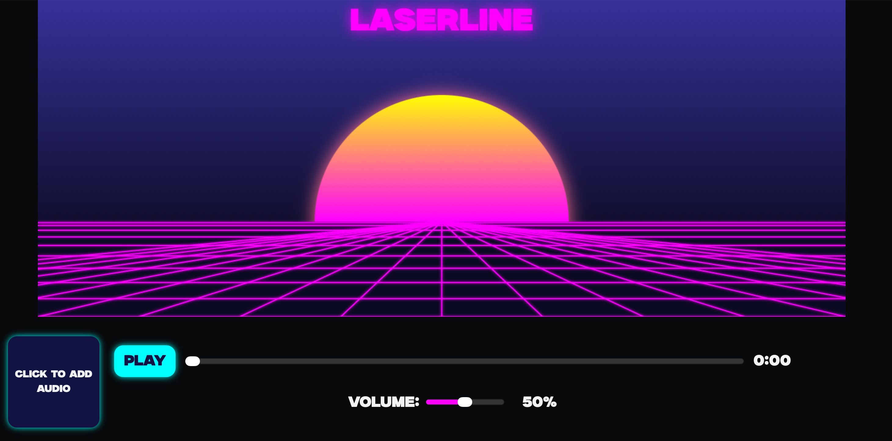

# Laserline
This site is a visualizer site I created for Crescent allowing for audio to be uploaded and a visualizer to be made.

## Preview

## Features
* Upload custom audio (MP3, .WAV .OGG)
* Load artwork of audio
* Volume slider
* Seek bar that updates based on song time
* Retrowave theme
* Visualizer bars
* A play pause button
* Site automatically adjusts per screen

## How to use
1. Click the small box on the left to pick your audio
2. Click play
3. Look at the visualizer

## Description
This site took me a while to create, the main issue has been debugging or just getting things to look how I'd like it to and styled. I am super happy with the end of this project overall and may even come back later on to ship some extra ideas I had.

## Getting started
No setup is required, head to <a href="https://waffles-888.github.io/Laserline/"> this link.</a> There you can access this project.

### Dependencies
This was created using javascript, CSS and html, all hosted using pages on github. Due to this being a site nothing is needed other than a browser and an internet connection to view the site.

## Issues I faced
I faced many challenges throughout developing the project, stemming from little CSS issues to needing to adjust lines of code that appear fine. The main learning curve was javascript, while I have used it on other projects It's still something I need to get comfortable with and I think this probably would be the biggest project I have worked on yet.

## Licence
MIT